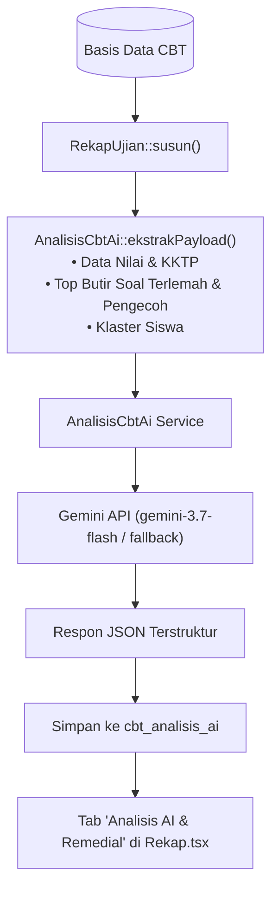

# Spesifikasi Teknis: Fitur Analisis CBT Berbasis AI & Remedial/Pengayaan

Dokumen ini merangkum arsitektur, struktur data, alur kerja, spesifikasi prompt AI, dan rancangan UI/UX untuk fitur **Analisis Diagnostik CBT Guru** di e-Rapor Al Akhyar.

---

## 1. Latar Belakang & Masalah
Saat ujian CBT selesai, guru saat ini hanya disajikan angka mentah (skor per siswa, tingkat kesukaran $p$, dan daya beda). Guru membutuhkan waktu lama untuk:
1. Membedah **mengapa** siswa banyak salah pada butir soal tertentu (identifikasi miskonsepsi & jebakan opsi).
2. Mengetahui **materi atau kompetensi spesifik** mana yang gagal dipahami kelas secara umum.
3. Memetakan siswa ke dalam **kelompok remedial** (< KKTP) dan **kelompok pengayaan** (≥ 85/90) secara otomatis beserta rekomendasi aktivitasnya.
4. Menyiapkan bahan ajar perbaikan untuk pertemuan kelas berikutnya serta dokumen pelaporan supervisi/arsip kurikulum.

---

## 2. Arsitektur & Alur Kerja Sistem



### Prinsip Utama:
- **Bebas Halusinasi (Data-Driven)**: AI tidak mengira-ngira hasil siswa, melainkan menganalisis data empiris yang sudah dihitung oleh sistem (`RekapUjian`).
- **Efisiensi Token**: Backend hanya mengirimkan ringkasan agregat, butir soal dengan kesalahan tinggi (> 40%), dan daftar nama siswa per kelompok skor.
- **Persistensi / Caching**: Hasil analisis disimpan di basis data agar tidak di-generate ulang setiap kali halaman dibuka, hemat token, dan instan bagi guru.

---

## 3. Skema Basis Data (`cbt_analisis_ai`)

```sql
CREATE TABLE cbt_analisis_ai (
    id BIGINT UNSIGNED AUTO_INCREMENT PRIMARY KEY,
    ujian_id BIGINT UNSIGNED NOT NULL,
    dibuat_oleh BIGINT UNSIGNED NOT NULL,
    model_ai VARCHAR(50) NOT NULL DEFAULT 'gemini-3.7-flash',
    hasil JSON NOT NULL,
    created_at TIMESTAMP NULL,
    updated_at TIMESTAMP NULL,
    FOREIGN KEY (ujian_id) REFERENCES cbt_ujian(id) ON DELETE CASCADE,
    FOREIGN KEY (dibuat_oleh) REFERENCES users(id) ON DELETE CASCADE,
    UNIQUE KEY unik_ujian_analisis (ujian_id)
);
```

---

## 4. Spesifikasi Kontrak AI (Prompt & JSON Schema)

### A. Payload Input (Dikirim Backend ke AI Gateway)
```json
{
  "ujian": "Informatika - PAS Ganjil",
  "mapel": "Informatika",
  "tingkat": 7,
  "kktp": 75,
  "total_peserta": 74,
  "rata_rata": 73.5,
  "nilai_tertinggi": 96,
  "nilai_terendah": 42,
  "persen_tuntas": 72,
  "soal_kritis": [
    {
      "nomor": 4,
      "jenis": "pilihan_ganda",
      "pertanyaan": "Situasi dunia nyata manakah yang paling tepat mencerminkan prinsip Queue?",
      "kunci": "Antrean membeli tiket bioskop",
      "tingkat_kesalahan_persen": 68,
      "pengecoh_terbanyak": "Tumpukan piring di tempat cuci (54% siswa memilih ini)"
    }
  ],
  "kelompok_remedial": [
    {"nama": "Ahmad Danar", "nilai": 58, "salah_pada_nomor": [4, 7, 12, 18]},
    {"nama": "Budi Santoso", "nilai": 64, "salah_pada_nomor": [4, 9, 12]}
  ],
  "kelompok_pengayaan": [
    {"nama": "Faiqah Adzkia", "nilai": 94},
    {"nama": "Aqlan Azzahidi", "nilai": 92}
  ]
}
```

### B. Payload Output (Respon JSON dari AI)
```json
{
  "ringkasan_eksekutif": "Tingkat ketuntasan kelas mencapai 72%. Secara umum pemahaman dasar baik, namun terdapat kendala pada materi abstraksi struktur data.",
  "area_kritis": [
    {
      "topik": "Struktur Data Antrean (Queue vs Stack)",
      "tingkat_kesulitan": "Tinggi",
      "masalah_utama": "Siswa gagal membedakan prinsip FIFO dan LIFO pada contoh aplikatif.",
      "saran_guru": "Gunakan analogi visual antrean kasir vs tumpukan buku di atas meja."
    }
  ],
  "bedah_soal": [
    {
      "nomor": 4,
      "miskonsepsi": "Siswa mengira proses yang terakhir masuk akan diproses lebih dulu.",
      "solusi_pembahasan": "Tekankan makna First-In First-Out dengan simulasi sederhana di kelas."
    }
  ],
  "rekomendasi_siswa": {
    "remedial": {
      "daftar_siswa": ["Ahmad Danar", "Budi Santoso"],
      "rekomendasi_tugas": "Latihan 5 soal diferensiasi FIFO vs LIFO dan membaca modul bab 2.",
      "teks_pesan_wa": "Assalamu'alaikum wr. wb. Berikut materi dan panduan tugas remedial CBT Informatika untuk ananda..."
    },
    "pengayaan": {
      "daftar_siswa": ["Faiqah Adzkia", "Aqlan Azzahidi"],
      "rekomendasi_aktivitas": "Mini proyek membuat pseudocode simulasi antrean tiket bioskop.",
      "teks_pesan_wa": "Assalamu'alaikum wr. wb. Selamat atas capaian istimewa ananda dalam asesmen CBT..."
    }
  },
  "refleksi_pertemuan_depan": [
    "Alokasikan 15 menit pertama pertemuan untuk membahas tuntas soal No. 4.",
    "Lakukan kuis cepat 2 soal sebelum melanjutkan ke pokok bahasan baru."
  ]
}
```

---

## 5. Rancangan UI/UX (Frontend `Rekap.tsx`)

Tab ke-3 ditambahkan pada halaman Rekap Nilai Ujian:
- **Tab 1**: Daftar Nilai Siswa
- **Tab 2**: Statistik Butir Soal (Tingkat Kesukaran & Daya Pembeda)
- **Tab 3**: **Analisis Diagnostik & Remedial AI 🤖**

### Struktur Komponen di Tab 3:
1. **Header Diagnostik**:
   - Status analisis (waktu generate terakhir, model yang dipakai).
   - Tombol **"Generate Ulang Analisis"** (`loading state` dengan spinner).
   - Tombol **"Cetak Lembar Analisis (PDF/Print)"** untuk laporan ke Kepala Sekolah/Pengawas.
2. **Kartu Ringkasan Eksekutif & Area Kritis**:
   - Kotak sorotan biru untuk capaian umum kelas.
   - Kartu merah untuk topik dengan tingkat kegagalan tertinggi.
3. **Accordion Bedah Soal Kritis**:
   - Daftar butir soal yang tingkat kesalahannya $> 40\%$.
   - Menampilkan nomor butir, persentase salah, opsi kunci, opsi pengecoh favorit, dan ulasan akar miskonsepsi dari AI.
4. **Kolom Pembagian Remedial & Pengayaan (Dual-Channel Delivery: WA & Dinar App)**:
   - **Kartu Remedial (Kiri - Aksen Merah/Kuning)**:
     - Daftar nama siswa < KKTP beserta nilai dan nomor soal yang salah.
     - Fokus materi yang perlu diperbaiki.
     - **Tombol Cepat**:
       - `[📋 Salin Format WhatsApp]`: Menyalin template pesan siap kirim ke WhatsApp wali murid / grup kelas.
       - `[📲 Kirim via Aplikasi Dinar]`: Menembakkan pesan remedial langsung ke kotak masuk (*notification inbox*) dan Push Notification HP siswa/wali murid via `NotificationDispatcher::keSiswa()`.
   - **Kartu Pengayaan (Kanan - Aksen Hijau/Biru)**:
     - Daftar nama siswa berprestasi tinggi (≥ 88).
     - Rekomendasi aktivitas/tantangan tingkat tinggi (mini proyek / studi kasus).
     - **Tombol Cepat**:
       - `[📋 Salin Format WhatsApp]`: Format apresiasi dan tantangan untuk WA.
       - `[📲 Kirim via Aplikasi Dinar]`: Mengirimkan tugas tantangan langsung ke akun Dinar siswa yang bersangkutan.
5. **Rencana Aksi Guru (Lesson Plan Reflection)**:
   - 2–3 poin rekomendasi praktis untuk pertemuan kelas berikutnya.

---

## 6. Saluran Pengiriman Pesan (WhatsApp & Dinar App)

Fitur ini menyediakan 2 opsi pengiriman pesan agar fleksibel:
1. **Saluran WhatsApp (Manual / Cepat)**:
   - Guru cukup klik tombol salin (*copy to clipboard*).
   - Teks sudah terformat rapi dengan *line break*, bolding (`*`), dan emoji khas pesan pengumuman guru.
2. **Saluran Aplikasi Dinar (Otomatis & Terpusat)**:
   - Menggunakan backend service yang sudah ada: `App\Services\NotificationDispatcher`.
   - Memanggil `NotificationDispatcher::keSiswa()` untuk setiap siswa di daftar target.
   - **Dua Efek Sekaligus**:
     1. Menulis ke tabel `notification_inbox` sehingga tersimpan rapi di menu Kotak Masuk aplikasi Dinar.
     2. Menembakkan *Push Notification* FCM ke HP siswa / wali murid dengan judul: *"Tugas Remedial CBT: [Nama Mapel]"* atau *"Tantangan Pengayaan CBT: [Nama Mapel]"*.

---

## 7. Tahapan Implementasi (Checklist)

- [ ] **Fase 1: Backend & Database**
  - Buat migration `create_cbt_analisis_ai_table`.
  - Buat model `App\Models\Cbt\AnalisisAi`.
  - Buat service `App\Services\Cbt\AnalisisCbtAi.php` yang memanggil `gemini.alakhyar.sch.id` (model `gemini-3.7-flash` dengan fallback).
- [ ] **Fase 2: Controller & Routing**
  - Tambahkan route `POST /cbt/ujian/{ujian}/analisis-ai` dan `GET /cbt/ujian/{ujian}/analisis-ai`.
  - Tambahkan otorisasi guru pengampu & admin sekolah di `PenilaianController`.
- [ ] **Fase 3: Frontend Interface**
  - Modifikasi `resources/js/Pages/Cbt/Ujian/Rekap.tsx` untuk menyertakan tab `analisis_ai`.
  - Buat komponen visual kartu area kritis, bedah soal, dan tabulasi remedial/pengayaan.
  - Tambahkan fungsi *one-click copy* pesan WhatsApp dan mode ramah cetak (`@media print`).
- [ ] **Fase 4: Pengujian & Verifikasi**
  - Uji end-to-end dengan data hasil ujian nyata di server produksi.
  - Verifikasi latensi respons AI (target $\le 8$ detik).
