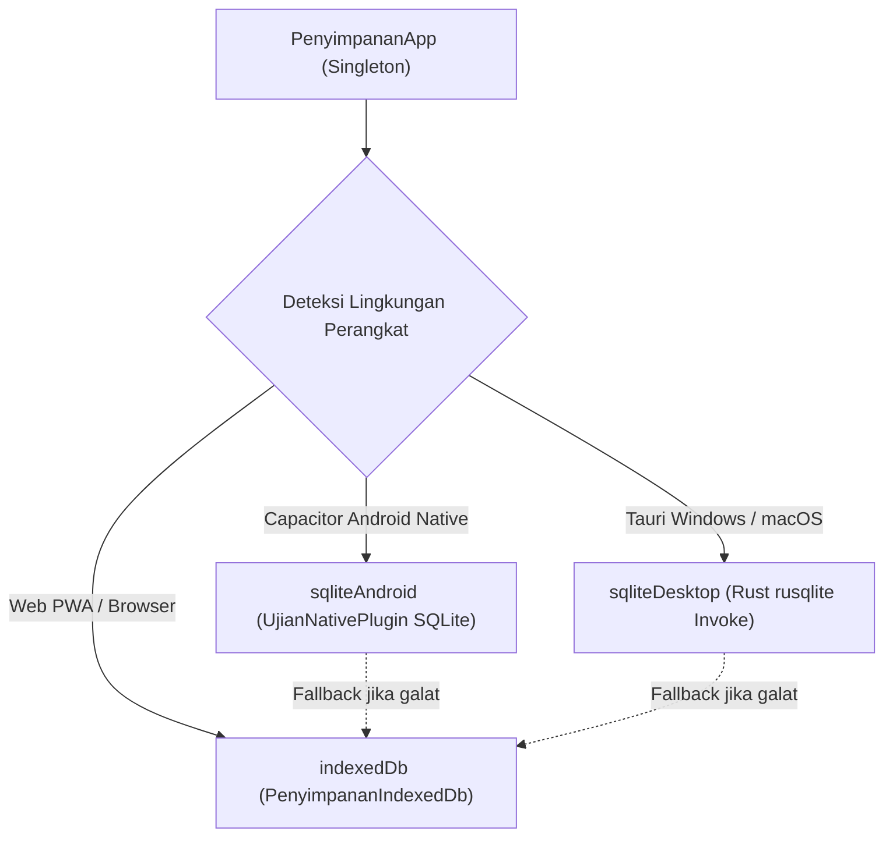

# Arsitektur Aplikasi Multiplatform & Sistem Penyimpanan Offline (Desktop & Mobile)

Dokumen ini memuat spesifikasi arsitektur resmi aplikasi murid **CBT Al Akhyar**, mencakup penyesuaian platform **Desktop (Windows & macOS)** serta implementasi sistem **Penyimpanan Offline Persisten (Story 6.5 & 7.7)**.

---

## 1. Matriks Platform & Pilihan Teknologi

Satu basis kode frontend (`apps/ujian`) dirilis ke 5 platform target untuk menjamin identitas render soal (rumus KaTeX, harakat Arab, tabel, dan media) tanpa duplikasi logika:

| Platform | Runtime / Cangkang | Mode Kiosk & Penguncian Layar | Sistem Penyimpanan Offline | Format Distribusi |
| :--- | :--- | :--- | :--- | :--- |
| **Android** | Capacitor 7 | `startLockTask()` + `FLAG_SECURE` (anti-screenshot & blokir app switch) | **SQLite Native** (`erapor_cbt.db` via `SQLiteOpenHelper`) | APK Langsung & Google Play Store |
| **iOS** | Capacitor 7 | Mode **Akses Terpandu (Guided Access)** bawaan iOS | IndexedDB / WebKit Storage | IPA & Apple App Store / TestFlight |
| **Windows Desktop** | **Tauri v2 (Rust + WebView2)** | Kiosk Layar Penuh (`fullscreen: true`, `decorations: false`, `alwaysOnTop: true`, blokir Alt+F4) | **SQLite Native** (`erapor_cbt.db` via `rusqlite` bundled) | Installer Windows (.exe NSIS & .msi) |
| **macOS Desktop** | **Tauri v2 (Rust + WKWebView)** | Kiosk Layar Penuh (`fullscreen: true`, `decorations: false`, `alwaysOnTop: true`, cegah penutupan) | **SQLite Native** (`erapor_cbt.db` via `rusqlite` bundled) | Apple Disk Image (.dmg) |
| **Web PWA** | Web Browser Modern (Chrome/Edge/Safari) | Layar Penuh browser (Pre-flight check di level Ketat/Lockdown) | **IndexedDB** (`erapor-cbt-ujian`) | URL Cloudflare Pages/Workers |

---

## 2. Kenapa Tauri v2 untuk Desktop Windows & macOS?

Sebelumnya pada dokumen awal direncanakan menggunakan *Safe Exam Browser (SEB)* atau web browser biasa pada laptop dan PC lab sekolah. Namun, tim memutuskan membangun **Aplikasi Desktop Mandiri berbasis Tauri v2**:

### Keunggulan Dibandingkan Alternatif Lain:
1. **Ukuran Sangat Ringan (~5–10 MB)**:
   - Jauh lebih efisien dibanding Electron (~120–150 MB) atau browser utuh.
   - Menggunakan engine web bawaan OS (Microsoft Edge WebView2 di Windows, Apple WebKit di macOS).
2. **Kiosk Mode Bawaan Tanpa Konfigurasi Rumit**:
   - Lab komputer sekolah tidak perlu repot mengonfigurasi sertifikat konfigurasi `.seb` yang rentan salah setting.
   - Aplikasi otomatis berjalan layar penuh, tanpa bilah tombol jendela OS, dan selalu berada di lapisan terdepan (*Always on Top*).
3. **Pencegahan Penutupan Sembarangan**:
   - Event `CloseRequested` pada Rust Tauri otomatis memanggil `api.prevent_close()` pada mode *Release*, sehingga siswa tidak bisa menutup ujian dengan pintasan `Alt + F4` atau `Cmd + W`.
   - Penutupan aplikasi hanya dapat dilakukan oleh pengawas melalui modal konfirmasi admin / pintasan `Ctrl + Shift + Q`.

---

## 3. Sistem Penyimpanan Offline: Evaluasi Alternatif & Implementasi

Story 6.5 dan 7.7 pada Backlog MVP mewajibkan:
> *"Jawaban tidak pernah hilang saat koneksi putus (offline 10 menit), dan data tidak terhapus otomatis oleh sistem operasi saat ruang memori menipis."*

### Evaluasi Alternatif Penyimpanan Desktop:

| Alternatif | Cara Kerja | Kelebihan | Kelemahan / Alasan |
| :--- | :--- | :--- | :--- |
| **Alternatif 1: IndexedDB Browser** | API database lokal peramban | Sudah ada di web, tanpa kode tambahan | **Beresiko**: Browser modern (terutama saat pembersihan cache atau mode privat) dapat menghapus IndexedDB saat storage penuh. |
| **Alternatif 2: LocalStorage / JSON File** | Membaca dan menulis berkas teks JSON | Sederhana | Tidak atomik; jika komputer mati mendadak saat menulis file, file JSON dapat korup. |
| **Alternatif 3: SQLite Native Bundled (Dipilih) 🌟** | Database SQLite embedded via Rust (`rusqlite`) di Desktop dan Java (`SQLiteOpenHelper`) di Android | **100% Persisten, Transaksional (ACID), Cepat, Aman dari Pembersihan Cache OS** | Memerlukan adapter bridge, namun performa dan keandalan maksimal. |

### Detail Implementasi SQLite Native:

#### A. Skema Basis Data Relasional
Tabel penyimpanan kunci-nilai terstandarisasi di semua platform native:
```sql
PRAGMA journal_mode = WAL;
PRAGMA synchronous = NORMAL;

CREATE TABLE IF NOT EXISTS erapor_cbt_kv (
    kunci TEXT PRIMARY KEY NOT NULL,
    nilai TEXT NOT NULL,
    diperbarui_pada INTEGER NOT NULL
);

CREATE INDEX IF NOT EXISTS idx_erapor_cbt_kv_kunci ON erapor_cbt_kv(kunci);
```

#### B. Lokasi Berkas Basis Data Persisten:
- **Windows Desktop**: `%APPDATA%\id.sch.alakhyar.cbt\erapor_cbt.db`
- **macOS Desktop**: `~/Library/Application Support/id.sch.alakhyar.cbt/erapor_cbt.db`
- **Android**: `/data/data/sch.alakhyar.ujian/databases/erapor_cbt.db`

#### C. Arsitektur Adapter di Frontend (`apps/ujian/src/lib/penyimpanan.ts`):


---

## 4. Rangkuman Bukti Pengujian (Test & Verification)

- **Unit Test Kontrak Penyimpanan (`packages/exam-core/test/penyimpanan.test.ts`)**:
  - 17 pengujian otomatis membuktikan kesetaraan kontrak (*contract equivalence*) antara `PenyimpananMemori`, `PenyimpananSqlite`, dan `PenyimpananSqliteNative` berperilaku 100% identik.
- **Unit Test Pemilihan Adapter (`apps/ujian/src/lib/penyimpanan.test.ts`)**:
  - Memverifikasi pemilihan `sqliteAndroid` saat berjalan di Android, `sqliteDesktop` saat berjalan di desktop Tauri, dan `indexedDb` di browser web.
- **Uji Ketahanan Offline (`packages/exam-core/test/offline.test.ts`)**:
  - Simulasi pemutusan koneksi 10 menit dengan 0 jawaban hilang atau dobel.
