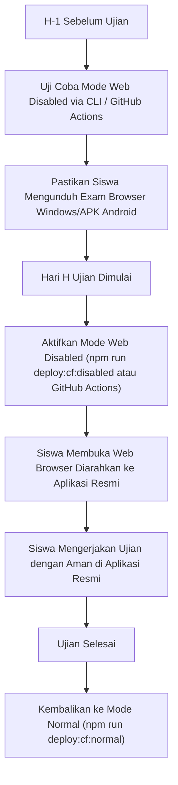

# Panduan Implementasi Mode Maintenance & Akses Web Disabled di Cloudflare

Dokumen ini menjelaskan secara menyeluruh **3 opsi implementasi** untuk mengatur mode **Pemeliharaan (Maintenance)** dan mode **Akses Web Dinonaktifkan (Web Disabled)** pada portal Ujian CBT e-Rapor Al Akhyar menggunakan ekosistem **Cloudflare**.

---

## 1. Latar Belakang & Kapan Digunakan

| Mode | Kapan Digunakan? | Perilaku yang Diharapkan |
| :--- | :--- | :--- |
| **Normal** | Hari sekolah biasa / latihan ujian murid. | Akses web browser (PWA) aktif penuh seperti biasa. |
| **Web Disabled** | **Ujian resmi / Penilaian Tengah & Akhir Semester.** Murid wajib menggunakan aplikasi resmi (Exam Browser Desktop Windows/macOS atau Aplikasi Android). | Web browser ditolak dan menampilkan instruksi untuk membuka aplikasi resmi. Cache & Service Worker browser murid langsung dibersihkan. |
| **Maintenance** | **Sinkronisasi nilai e-Rapor, pemeliharaan server, atau update besar.** | Seluruh akses menampilkan pesan pemeliharaan server berkala. |

> [!IMPORTANT]
> **Masalah Umum Cache PWA & Service Worker:**
> Pada web browser modern, PWA menyimpan cache aset di *Cache Storage* dan *Service Worker*. Jika Anda hanya mengganti tampilan web biasa tanpa membersihkan Service Worker, murid yang pernah membuka CBT sebelumnya mungkin akan tetap melihat halaman login lama dan mengalami galat (*stuck*). 
> **Opsi 1** di bawah ini dirancang khusus untuk otomatis meng-uninstall Service Worker dan membuang cache lama di HP/laptop murid secara instan.

---

## 2. Ringkasan & Perbandingan 3 Opsi

| Kriteria | Opsi 1: Build & Wrangler Deploy (Rekomendasi Utama) | Opsi 2: Cloudflare WAF Custom Rule (Instan Dashboard) | Opsi 3: Worker Environment Variable Toggle |
| :--- | :--- | :--- | :--- |
| **Kecepatan Aktivasi** | 10 - 20 detik (via CLI / GitHub Actions) | **Instan (3 detik)** via Toggle Switch | Instan (5 detik) via Dashboard Variable |
| **Pembersihan Cache PWA Siswa** | **Otomatis & Bersih Total** (ada script unregister SW) | Perlu disisipkan manual di HTML response | Otomatis jika disisipkan di HTML response |
| **Kemudahan Bagi Non-Dev** | Sangat mudah via dropdown GitHub Actions | Sangat mudah via tombol ON/OFF WAF | Sedang (ubah nilai variabel text) |
| **Kebutuhan Server / Biaya** | Gratis (Cloudflare Workers Static Assets) | Gratis (Cloudflare Free WAF Rule) | Gratis (Cloudflare Workers) |
| **Bisa Whitelist IP Pengawas?** | Via routing server backend | **Bisa langsung di WAF expression** | Bisa via pemeriksaan header/IP di Worker |

---

## 3. OPSI 1: Build & Deploy via Wrangler (Sangat Direkomendasikan)

Metode ini menggunakan skrip generator bawaan repositori ([`scripts/generate-maintenance-pwa.mjs`](../scripts/generate-maintenance-pwa.mjs)) dan konfigurasi [`wrangler.json`](../wrangler.json).

### Keunggulan:
- Menghasilkan bundle HTML statis mandiri di `./apps/ujian/dist`.
- Menginjeksi **Service Worker pembersih (`sw.js`)** yang memaksa semua browser murid menghapus cache ujian lokal lama.
- Tampilan responsif, modern, dan sesuai standar branding Al Akhyar (`#006195`).

---

### Cara 1.A: Perintah Cepat via Terminal (CLI)

Jalankan perintah ini di komputer kerja atau server build:

```bash
# -------------------------------------------------------------
# 1. NONAKTIFKAN AKSES WEB (Saat Ujian Resmi Dimulai)
# -------------------------------------------------------------
# a. Blokir semua browser (iPhone/iPad ikut terblokir):
npm run deploy:cf:disabled
# b. Blokir laptop & Android, iPhone/iPad tetap lewat PWA terpasang:
npm run deploy:cf:ios-only

# -------------------------------------------------------------
# 2. AKTIFKAN MODE MAINTENANCE (Saat Pemeliharaan Server)
# -------------------------------------------------------------
npm run deploy:cf:maintenance

# -------------------------------------------------------------
# 3. KEMBALIKAN KE MODE NORMAL (Setelah Selesai Ujian / Maintenance)
# -------------------------------------------------------------
npm run deploy:cf:normal
```

#### Memberikan Pesan Kustom:
Jika ingin memberikan keterangan khusus (misal: jam selesai pemeliharaan):
```bash
node scripts/generate-maintenance-pwa.mjs --mode maintenance --message "Server sedang sinkronisasi nilai rapor. Layanan akan aktif kembali pukul 14:00 WITA."
npm run deploy:cf
```

---

### Cara 1.B: Deploy Satu Klik via GitHub Actions

Admin / Pengawas tidak perlu membuka terminal atau koding sama sekali:

1. Buka repositori di **GitHub** → Tab **Actions**.
2. Di bilah kiri, pilih alur **Deploy PWA**.
3. Klik menu tombol **Run workflow** di sebelah kanan.
4. Tentukan parameter:
   - **Target Environment**: `production` atau `staging`
   - **PWA Deployment Mode**:
     - `normal`: Membangun aplikasi PWA lengkap.
     - `web_disabled`: Membangun halaman penonaktifan web browser (semua perangkat, termasuk iPhone/iPad).
     - `web_ios_only`: App penuh hanya untuk PWA terpasang di iPhone/iPad; laptop & Android diarahkan ke halaman penonaktifan.
     - `maintenance`: Membangun halaman pemeliharaan sistem.
   - **Custom Notice Message**: *(Opsional)* Tulis pesan khusus jika ada.
5. Tekan tombol hijau **Run workflow**. Dalam waktu ~30 detik, status web di Cloudflare akan otomatis terperbarui.

> **Prasyarat GitHub Secrets:**
> Pastikan secret `CLOUDFLARE_API_TOKEN` dan `CLOUDFLARE_ACCOUNT_ID` sudah didaftarkan pada repositori GitHub (`Settings → Secrets and variables → Actions`).

---

## 4. OPSI 2: Instan via Cloudflare Dashboard (WAF Custom Rules)

Opsi ini sangat cocok ketika Anda membutuhkan solusi **darurat / instan dalam 3 detik** langsung dari web browser tanpa perlu build atau deploy git.

### Langkah-langkah Pengaturan:

1. Masuk ke [Cloudflare Dashboard](https://dash.cloudflare.com/) → Pilih domain sekolah Anda (misal `alakhyar.sch.id`).
2. Masuk ke menu **Security** → **WAF** → tab **Custom rules**.
3. Klik tombol **Create rule**.
4. Isi data konfigurasi rule:
   - **Rule name**: `Mode Ujian - Nonaktifkan Akses Web`
   - **If incoming requests match (Expression Builder)**:
     Ganti ke mode **Edit expression** dan tempel aturan berikut:
     ```text
     (http.host eq "cbt.alakhyar.sch.id" and not ip.src in {180.252.12.34} and not starts_with(http.request.uri.path, "/api/"))
     ```
     > **Tips:** Ganti `180.252.12.34` dengan IP Publik ruang server/kantor pengawas jika ingin pengawas tetap bisa membuka web. Jika tidak perlu IP Whitelist, gunakan:
     > `(http.host eq "cbt.alakhyar.sch.id" and not starts_with(http.request.uri.path, "/api/"))`

5. **Then take action...**:
   - Pilih aksi: **Block**
   - Centang opsi **Custom response**:
     - **Response code**: `503` (jika Maintenance) atau `200` / `403` (jika Web Disabled).
     - **Response type**: `HTML` (`text/html`)
     - **Response body**: Salin dan tempel kode HTML respons di bawah ini:

#### Template HTML untuk Cloudflare WAF Custom Response:
```html
<!DOCTYPE html>
<html lang="id">
<head>
  <meta charset="UTF-8">
  <meta name="viewport" content="width=device-width, initial-scale=1.0">
  <title>Akses Web CBT Dinonaktifkan · Al Akhyar</title>
  <link rel="preconnect" href="https://fonts.googleapis.com">
  <link rel="preconnect" href="https://fonts.gstatic.com" crossorigin>
  <link href="https://fonts.googleapis.com/css2?family=Plus+Jakarta+Sans:wght@400;600;700;800&display=swap" rel="stylesheet">
  <style>
    * { box-sizing: border-box; margin: 0; padding: 0; }
    body {
      font-family: 'Plus Jakarta Sans', system-ui, -apple-system, sans-serif;
      background-color: #F5F8FA; color: #1E2A32; min-height: 100vh;
      display: flex; align-items: center; justify-content: center; padding: 1.5rem 1rem;
    }
    .card {
      width: 100%; max-width: 540px; background: #FFF; border-radius: 24px;
      box-shadow: 0 14px 34px rgba(16,42,66,0.08); border: 1px solid #E1E7ED;
      overflow: hidden; text-align: center;
    }
    .header {
      background: linear-gradient(135deg, #006195 0%, #004268 100%);
      padding: 1.5rem 2rem; color: #FFF; font-weight: 700; font-size: 1.1rem;
    }
    .body { padding: 2rem; }
    .badge {
      display: inline-block; background: #FEE2E2; color: #991B1B;
      font-size: 0.78rem; font-weight: 700; text-transform: uppercase;
      padding: 0.35rem 0.85rem; border-radius: 9999px; margin-bottom: 1rem;
    }
    h1 { font-size: 1.35rem; font-weight: 800; color: #1E2A32; margin-bottom: 0.75rem; }
    p { font-size: 0.92rem; color: #6B7683; line-height: 1.6; margin-bottom: 1.5rem; }
    .apps {
      background: #F8FAFC; border: 1px solid #EEF2F6; border-radius: 16px;
      padding: 1.25rem; text-align: left; font-size: 0.85rem; font-weight: 600; color: #3F4B55;
    }
    .apps ul { list-style: none; margin-top: 0.5rem; display: grid; gap: 0.5rem; }
    .apps li { background: #FFF; padding: 0.6rem 0.85rem; border-radius: 10px; border: 1px solid #E1E7ED; }
  </style>
</head>
<body>
  <div class="card">
    <div class="header">CBT Al Akhyar · Exam Portal</div>
    <div class="body">
      <div class="badge">Wajib Menggunakan Aplikasi Resmi</div>
      <h1>Akses Peramban Web Dinonaktifkan</h1>
      <p>Demi menjaga integritas dan keamanan ujian, akses ujian melalui browser web dinonaktifkan. Silakan gunakan Aplikasi Resmi CBT Al Akhyar:</p>
      <div class="apps">
        <strong>Aplikasi Resmi yang Diizinkan:</strong>
        <ul>
          <li>💻 Windows Exam Browser (.exe / .msi)</li>
          <li>🍎 macOS Exam Browser (.dmg)</li>
          <li>📱 Android APK Resmi Al Akhyar</li>
          <li>📱 iOS App (Akses Terpandu)</li>
        </ul>
      </div>
    </div>
  </div>
  <script>
    if ('serviceWorker' in navigator) {
      navigator.serviceWorker.getRegistrations().then(r => r.forEach(reg => reg.unregister()));
    }
    if ('caches' in window) {
      caches.keys().then(keys => keys.forEach(k => caches.delete(k)));
    }
  </script>
</body>
</html>
```

6. Klik **Deploy**.
7. **Cara Mengaktifkan / Menonaktifkan:**
   - Di daftar WAF Custom Rules, cukup geser tombol sakelar (**Toggle Switch**) menjadi **ON** (saat ujian dimulai) atau **OFF** (saat ujian selesai).

---

## 5. OPSI 3: Middleware di Cloudflare Worker (Environment Variable)

Jika Anda ingin mengontrol mode melalui tombol teks sederhana di menu Cloudflare Workers tanpa menyentuh WAF:

### Langkah-langkah Pengaturan:

1. Di file [`wrangler.json`](../wrangler.json), daftarkan script worker utama:
   ```json
   {
     "$schema": "node_modules/wrangler/config-schema.json",
     "name": "erapor-cbt",
     "main": "src/worker.ts",
     "compatibility_date": "2026-10-16",
     "assets": {
       "directory": "./apps/ujian/dist",
       "not_found_handling": "single-page-application",
       "html_handling": "auto-trailing-slash"
     },
     "vars": {
       "MAINTENANCE_MODE": "false",
       "WEB_DISABLED": "false"
     }
   }
   ```

2. Buat berkas `src/worker.ts`:
   ```typescript
   export default {
     async fetch(request: Request, env: any): Promise<Response> {
       const url = new URL(request.url);

       // Jangan blokir API backend jika request diarahkan ke path API
       if (url.pathname.startsWith('/api/')) {
         return env.ASSETS.fetch(request);
       }

       if (env.MAINTENANCE_MODE === 'true') {
         return new Response(
           `<!DOCTYPE html><html><head><meta charset="utf-8"><title>Pemeliharaan</title></head>
            <body style="font-family:sans-serif;text-align:center;padding:50px;">
              <h1>Sistem Dalam Pemeliharaan</h1>
              <p>Mohon menunggu hingga sinkronisasi data selesai.</p>
            </body></html>`,
           { status: 503, headers: { 'Content-Type': 'text/html; charset=utf-8' } }
         );
       }

       if (env.WEB_DISABLED === 'true') {
         return new Response(
           `<!DOCTYPE html><html><head><meta charset="utf-8"><title>Akses Web Ditutup</title></head>
            <body style="font-family:sans-serif;text-align:center;padding:50px;">
              <h1>Akses Web Browser Dinonaktifkan</h1>
              <p>Silakan gunakan Aplikasi Resmi CBT Al Akhyar (Windows/Android/iOS).</p>
            </body></html>`,
           { status: 403, headers: { 'Content-Type': 'text/html; charset=utf-8' } }
         );
       }

       return env.ASSETS.fetch(request);
     }
   };
   ```

3. **Cara Ubah Status:**
   - Masuk ke Cloudflare Dashboard → **Workers & Pages** → `erapor-cbt` → **Settings** → **Variables and Secrets**.
   - Ubah `WEB_DISABLED` atau `MAINTENANCE_MODE` menjadi `"true"` atau `"false"`.

---

## 6. Prosedur Operasional Standar (SOP) Sekolah



### Checklist Admin Pelaksanaan Ujian:
- [ ] **H-1 Ujian**: Pastikan versi installer desktop Windows/macOS dan APK Android sudah dibagikan ke siswa/lab.
- [ ] **15 Menit Sebelum Ujian**: Jalankan `npm run deploy:cf:disabled` (atau via GitHub Actions).
- [ ] **Saat Ujian Berlangsung**: Periksa apakah ada siswa yang masih mencoba membuka via Google Chrome / Safari; pastikan muncul tampilan instruksi aplikasi resmi.
- [ ] **Setelah Ujian Selesai**: Jalankan `npm run deploy:cf:normal` agar portal web kembali aktif untuk review atau penggunaan harian.
